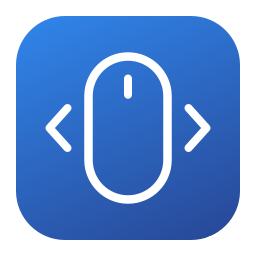

# SideBack



A macOS utility that makes mouse side buttons navigate back and forward in applications that do not support them natively.

(I'm not gonna buy your mouse, Apple!)

## Features
- Launch at boot
- Dynamically select apps (Safari & Finder enabled by default)
- Swap back and forward

## Build and run

The generated Xcode project is checked in, so XcodeGen is not needed for an ordinary build.

```sh
make run
```

This builds a locally ad-hoc-signed app and opens:

```text
build/Build/Products/Debug/SideBack.app
```

Alternatively, open `SideBack.xcodeproj`, select the SideBack scheme, choose a signing team if available, and run.

For a universal, optimized local build:

```sh
make release
```

The universal build result is `build/Build/Products/Release/SideBack.app`.
